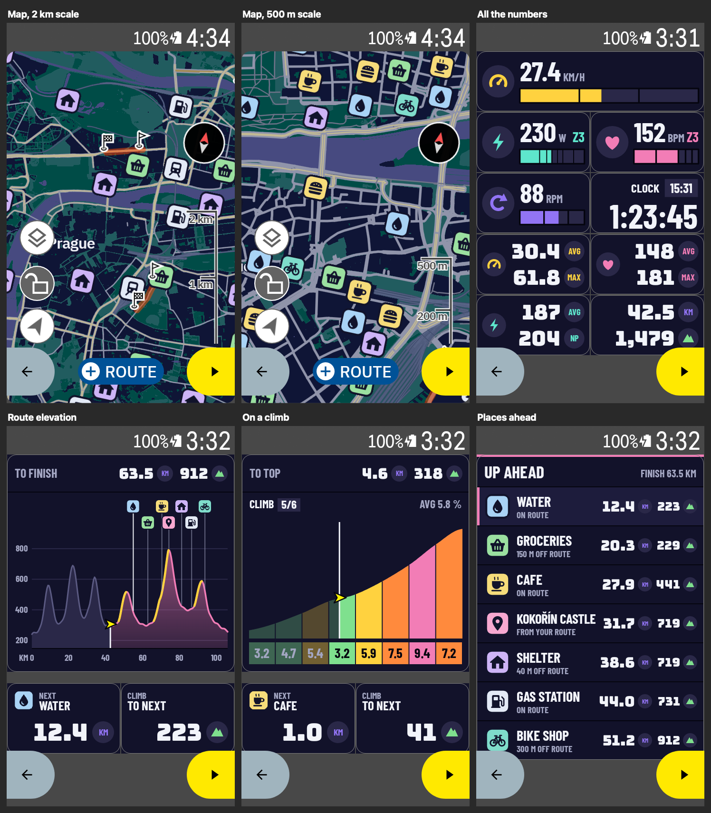
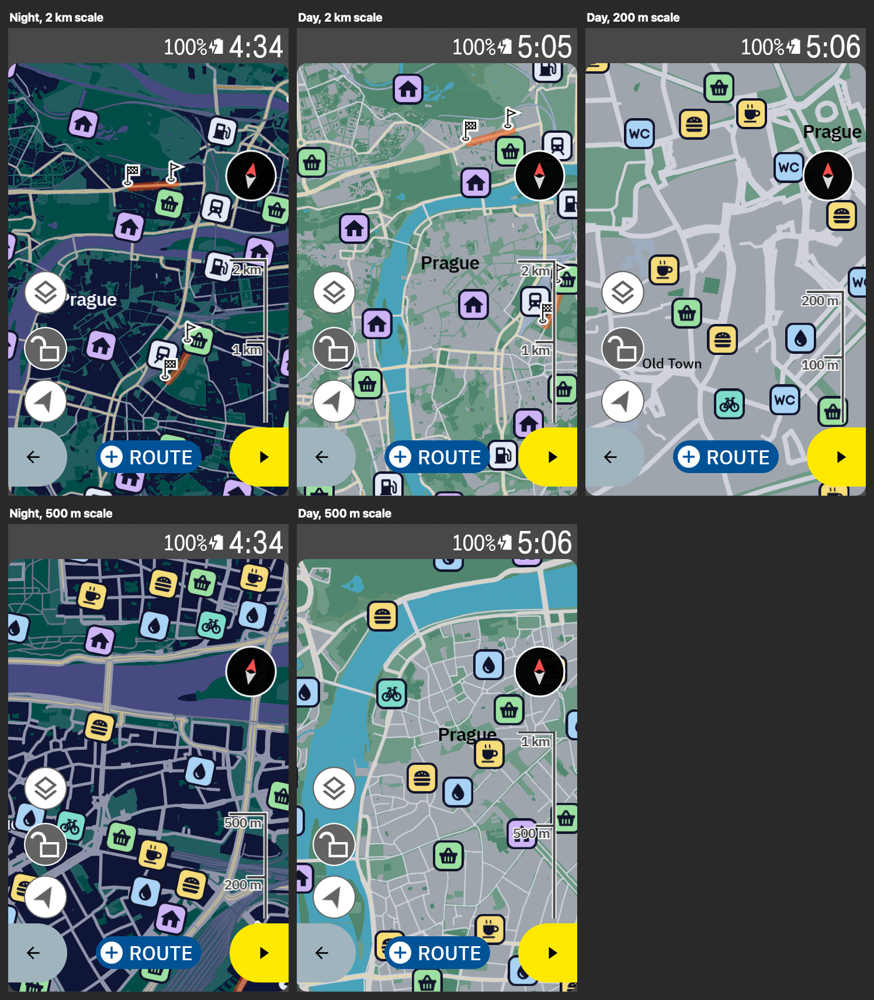
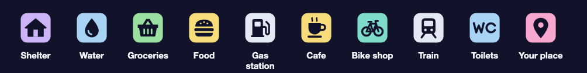
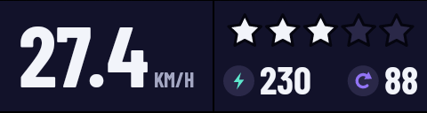

# karoo-neon-map

A neon map look, map icons and data fields for the **Hammerhead Karoo 2**, inspired by the look
of the GTA VI in-game map.

> A fan project. It is not made, endorsed or supported by Rockstar Games, Take-Two Interactive or
> Hammerhead. No game artwork, logos or fonts are used: every colour, icon and field here is
> drawn from scratch, and the fonts are free ones.

All pictures are real screenshots from a Karoo 2. The numbers on the data pages are made up
(a desk test), and so is the route on the navigation pages.

### By day and by night

The day theme is for sunlight: lighter land and grey towns, dark labels. The night theme is the
neon one. The extension switches between them with the Karoo's Dark Mode, or keeps one of them
if you set it to "Always day" or "Always night".

## What is in here, and what is not

- **The map's look, not the map.** The themes tell the Karoo how to draw its own map: colours,
  line widths, which roads and places show from which zoom. The map itself (streets, land,
  houses) is still Hammerhead's own offline maps, the ones you download on the Karoo as usual.
  Nothing here downloads or replaces map data.
- **The extension** that puts the theme in place, draws the icons and the data fields.
- **The tools that make it**: the colour tables, the icon drawings and the place list script.
- Not here: anything from the game.

## What you get

- **A map theme for the Karoo's own map**, by day and by night: at night teal land and navy
  towns, by day lighter green land and grey towns; grey roads with gold motorways, houses in 3D
  from the closest zoom. It follows the Karoo's Dark Mode.
- **Map icons** for shelters, drinking water, groceries, food, gas stations, cafes, bike shops,
  train stations and toilets, from OpenStreetMap. Gas stations, supermarkets, shelters and train
  stations show from the 10 km scale, the rest from 500 m, toilets from 200 m. Icons never sit
  on top of each other, and a street full of restaurants gets one burger.

  

- **Zoom by speed**: while a ride is recording, the map zooms out as you go faster.
- **Data fields** that draw their whole cell, in the look of the game's displays:

| Field (as the Karoo's field picker lists it) | Shows |
|---|---|
| Wanted level | Heart rate as five stars, one per heart-rate zone. Flashes red in the top zone. |
| Health bar, Stamina bar, Focus bar, Speed bar | Heart rate, 3 s power, cadence and speed as bars split at your zones |
| Speed, big | Speed in large numbers |
| Map row, right half: stars, watts, cadence | Beside "Speed, big" above the map: the thinnest row the Karoo gives |
| Map row: speed, stars, watts, cadence | All four in one cell (alone above the map the Karoo makes its row taller) |
| Distance and climb | Distance ridden and metres climbed, like the game's money counters |
| Speed / Heart rate / Power: average and max (NP) | Two counters in one cell |
| Ride time and clock | Ride time large, the time of day in a small box |
| Route elevation | The route's heights with the places ahead and climbs in yellow. On a climb it shows the climb, cut in pieces coloured by steepness |
| Next place: distance, Next place: climb | How far, and how much climbing, to the next place on the route |
| Places ahead | A list of the next places along the route, with distance and climb to each. Best alone on a page |

- **An optional colour overlay** for the ride app's route, reroute and climb lines (`overlay/`).
  It needs adb and one restart of the Karoo.

## Status

Tested on a Karoo 2 on the desk, with made-up values and with a real "Nav To" route. **Not yet
tried on a ride with real sensors.** Not tried on a Karoo 3.

The place list in the ready-made build covers **the Czech Republic only** (and part of Austria).
Elsewhere the map icons stay empty until you build a list for your region (see "Build").

## Install

- **With the Karoo companion app**: sideload it with this link:
  `https://github.com/mopheadpersona/karoo-neon-map/releases/latest/download/manifest.json`
- **With adb** (developer mode and USB debugging on): download `karoo-neon-map.apk` from the
  latest release, then

      adb install -r -g karoo-neon-map.apk

  `-g` gives it storage access at once, which it needs for the map theme.

Then add the fields in the Profiles app: a page, "Add field", scroll to the end, "GTA VI MAP".
On the Karoo the extension is listed as "GTA VI map".

**What it changes on your Karoo.** The map theme works by replacing the ride app's theme file,
`/sdcard/offline_v15.xml`. Hammerhead's own file is kept as `/sdcard/offline_v15_ORIGINAL.xml`.
The extension's own screen (apps list, "GTA VI map") has the switches (map theme, zoom by
speed, map icons, icon size, fonts) and a button "Put Hammerhead's map back". Press it before
you uninstall the extension, or the neon theme stays.

## Build

You need Java 17 or newer and the Android SDK (platform 34, build tools 34.0.0). Gradle comes
with the wrapper.

1. Fetch the fonts: `extension/fonts/README.md`.
2. Build a place list for your region, from OpenStreetMap through the public Overpass servers:

       python3 make_places.py fetch czech-republic
       python3 make_places.py pack

   The regions are in the table at the top of `make_places.py`; add yours the same way.
3. Build the extension:

       sh extension/build.sh

   The app ends up in `extension/app/build/outputs/apk/debug/app-debug.apk`.

The look is in tables, not in the files they write: `make_style.py` (colours and widths),
`make_karoo_theme.py` (writes `karoo-native/`), `make_icons.py` (writes `icons/` and the app's
icon drawables). `tools/native.py` puts a theme on the Karoo over adb without the extension.

## Licences

- This project's code, icons and themes: MIT (`LICENSE`).
- `extension/karoo-ext-lib/`: Hammerhead's karoo-ext SDK, Apache 2.0 (its `LICENSE`).
- Fonts (Barlow Condensed, Bebas Neue, Bungee, Russo One, from Google Fonts): SIL Open Font
  Licence 1.1. They ship inside the app with their licences.
- Place list: © OpenStreetMap contributors. The list built into the app is a database under the
  Open Database Licence (ODbL) 1.0; `make_places.py` makes it.
- GTA VI is a trademark of Take-Two Interactive. Karoo and Hammerhead are trademarks of their
  owners. They are named here only to say what this project is inspired by and what it runs on.
